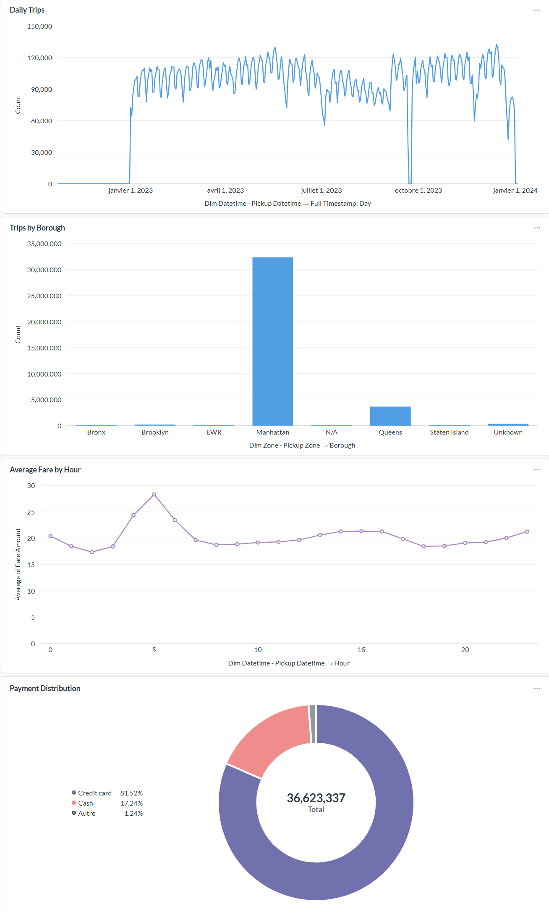
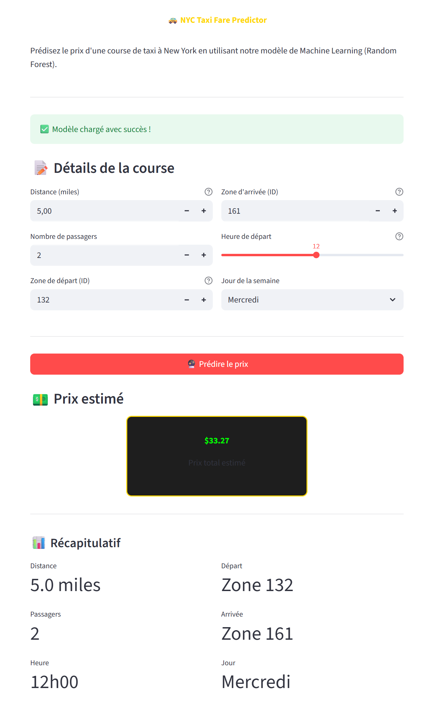

# NYC Taxi Pipeline

One year of New York yellow-taxi trips (2023, 38.4M rows) pulled from the TLC open data,
validated with Spark, loaded into a PostgreSQL star schema, explored in Metabase, and used to
train a fare prediction model served by a small Streamlit app. An Airflow DAG chains the
steps. Everything runs in Docker Compose.

This was the Big Data module project at CY Tech (ING3, 2025-2026). The subject gave us the
steps; the work was making them hold up on real volumes on one 30 GB server.

## How it fits together

```
TLC CDN (12 monthly Parquet files, 2023)
   |  ingestion/downloader   Scala + MinIO SDK, streamed straight into the bucket
   v
MinIO  nyc-raw/2023/
   |  ingestion/spark        Spark 3.5 (Scala): schema normalisation + business rules
   v
MinIO  nyc-validated/2023/   36.6M rows
   |                        \
   |  ingestion/spark        \  ml_service/src/preprocessing.py  (200k stratified sample)
   v                          v
PostgreSQL star schema        Random Forest  ->  Streamlit app (:8501)
   |  warehouse/*.sql  5 dimensions + fact_trip
   v
Metabase dashboard (:3000)    SQL of the four charts in dashboard/queries.sql

orchestration/dags/  Airflow: validate_and_load -> check_warehouse -> ml_preprocessing -> ml_training
docker/              Dockerfiles for the Spark, Airflow and ML service images
```

## Data and validation

The raw files are not consistent with each other: the airport fee column is `Airport_fee`
in some months and `airport_fee` in others, and integer columns switch between int and long.
The validator first casts every month to one schema, then keeps a row only if all amounts
are >= 0, passenger count and distance are >= 0, vendor, rate code, payment type and
store-and-forward flag are in the TLC code lists, and dropoff is not before pickup.

For 2023 that is 38,407,504 rows read and about 36.6M kept (95 %); the rejection rate goes
from 3 % to 7 % depending on the month. The `>= 0` filters also drop rows where a surcharge
is null, which is part of those 5 %. Each month is written to its own folder with overwrite,
so re-running the validation does not duplicate data (the first version appended).

## Warehouse

PostgreSQL 16, star schema: `fact_trip` (36,623,337 rows, one per trip with all the amounts)
and five dimensions: `dim_datetime` (24,296,188 distinct pickup/dropoff timestamps),
`dim_zone` (265), `dim_vendor` (4), `dim_ratecode` (7), `dim_payment_type` (7). Foreign keys
everywhere, indexes on the fact table keys. The database is about 11 GB.

The fact table gets its datetime keys by joining the trips with `dim_datetime` on the
timestamp, and that join is the expensive part: the dimension has 24M rows, almost as many as
the facts. The first run, with a 4 GB heap, died after about 7M inserted rows (PostgreSQL
logged "unexpected EOF on client connection with an open transaction"). What fixed it, on a
30 GB server: a 16 GB heap with G1 (`javaOptions` in `ingestion/spark/build.sbt`), an explicit
`broadcast` of the dimension so the 36M trips are not shuffled twice, and writing the fact
table through 8 partitions, i.e. 8 parallel JDBC connections. The full load then took about
37 minutes, roughly 1.5M rows per minute.

## Dashboard



Four Metabase questions: trips per day, trips per pickup borough, average fare per hour,
payment type split. Around 100k trips a day with the weekly rhythm clearly visible; about 32M
of the 36.6M pickups are in Manhattan, Queens second because of the two airports; 81.5 % of
trips paid by card, 17.2 % in cash; the average fare peaks around 5 am (about $28, airport
runs) and stays between $17 and $21 the rest of the day. The daily chart also has two gaps
(first days of January, early October) that I did not trace before the deadline; the per-month
validation counts are normal, so the rows went missing in the warehouse load.

## Fare prediction

`ml_service/` predicts `total_amount` from seven features: distance, passenger count, pickup
and dropoff zone ids, hour, day of week, weekend flag. The pipeline reads the validated
Parquet from MinIO, drops the obvious garbage (amount <= 0 or >= 500, distance <= 0 or
>= 100, no passengers), takes a 200k-row sample stratified by price band so the rare
expensive trips are represented, splits 80/20 and fits a `RandomForestRegressor` inside a
scikit-learn pipeline. We trained on a sample because 36M rows did not fit next to the rest
of the stack on the server; the Streamlit container is capped at 4 GB.

On the 20 % held-out part of the sample: RMSE 6.56, MAE 3.50, R² 0.91 (the target set by the
subject was RMSE < 10). Train RMSE was 5.89, so some overfitting but nothing dramatic. The
committed `train.py` is slightly more regularised than the run that produced those numbers
(250 trees, depth 12, at least 5 samples per leaf, instead of 100 trees and depth 15), so
expect a figure in the same range rather than exactly 6.56. The 5-fold cross-validation in
`train.py` runs on the training split only.



## Orchestration

The DAG has four tasks, all `DockerOperator`s on the compose network: Spark validation and
load (fat jar, local mode, 16 GB driver), a row count on `fact_trip`, ML preprocessing, ML
training. The ML tasks use the same image as the Streamlit service, so the model is always
loaded with the scikit-learn version that produced it. No schedule: the 2023 data does not
change, so it is triggered by hand.

Airflow was the last step before the deadline. The DAG parses and triggers, but I have no clean
end-to-end run through it to show; the warehouse and the model came from the manual runs below.

## Running it

You need Docker with about 20 GB free and, for the Scala jobs, a JDK 17 and sbt. The Spark
job asks for a 16 GB heap; lower `-Xmx` in `ingestion/spark/build.sbt` on a smaller machine.

```bash
cp .env.example .env             # set the passwords and PROJECT_DIR
docker compose up -d --build     # Spark, MinIO, PostgreSQL (schema created at start), Metabase, ML service, Airflow

set -a; source .env; set +a
(cd ingestion/downloader && sbt run)     # 1. 2023 files into MinIO (about 1 GB)
(cd ingestion/spark && sbt run)          # 2. validate + load the warehouse (37 min on a 30 GB server)

docker compose run --rm ml-service python src/preprocessing.py   # 3. sample + clean
docker compose run --rm ml-service python src/train.py           #    train, then open http://localhost:8501

(cd ingestion/spark && sbt assembly)     # 4. optional: fat jar for the DAG, then trigger it at http://localhost:8080
```

Metabase (http://localhost:3000) needs a one-time setup: create the admin account, add the
`taxi` database on host `postgres`, then paste the queries from `dashboard/queries.sql`.
Spark UI on 8081, MinIO console on 9001. ML unit tests: `pytest ml_service/tests`.

I cleaned this repository up after the module without sbt or a Docker daemon at hand: the Python
tests pass and the compose file validates, but the Scala jobs were not recompiled here.

## Limitations and what I would change

- `dim_datetime` at second granularity was a design mistake: 24M rows for 36M facts and a heavy
  join. A date dimension plus an hour column, with timestamps kept in the fact table, would do.
- The heavy work runs in Spark local mode in one JVM. The standalone cluster in the compose
  file is there, but its 2 GB workers cannot do this join; either size them or drop them.
- The model treats zone ids as numbers. Target-encoding the zones, or at least borough and
  airport flags, is the obvious next step; so is predicting `fare_amount` rather than
  `total_amount`, since tips are not predictable from the trip itself.
- A random split on 2023 data says nothing about drift; a time-based split (train January to
  September, test October to December) would be a fairer test for a service used afterwards.
- `fact_trip` has no natural key, so a second `sbt run` appends the trips again; reloading
  from scratch means `docker compose down -v`.

## Context

Big Data module, CY Tech, ING3 (2025-2026). Team: Haroun Joudi, Amine Filali, Mouad Ouad.
I set up and ran the stack on our server, wrote the Spark validation and ingestion job and
the warehouse schema and fixed the memory problems described above, built the Metabase
dashboard, and wired the fare-prediction service and the Airflow DAG into the stack. Those
two started from an existing version that I adapted to this stack and deployed.
